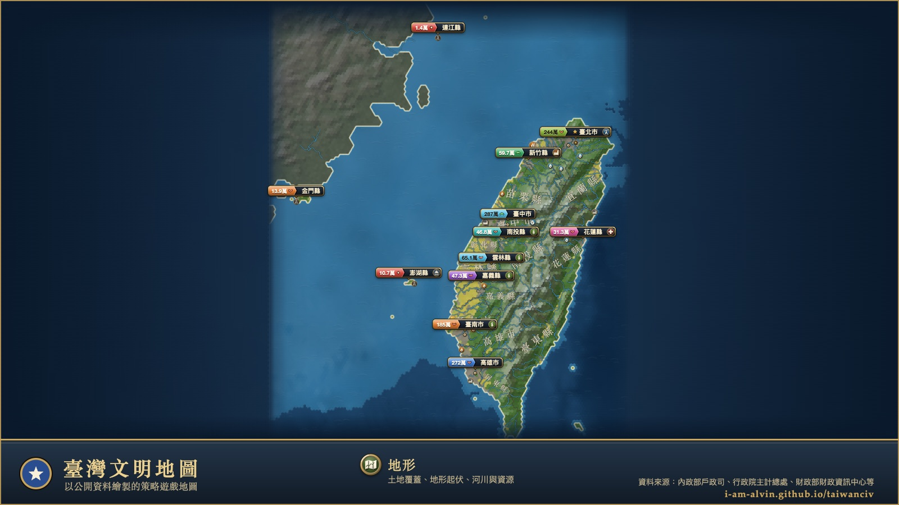
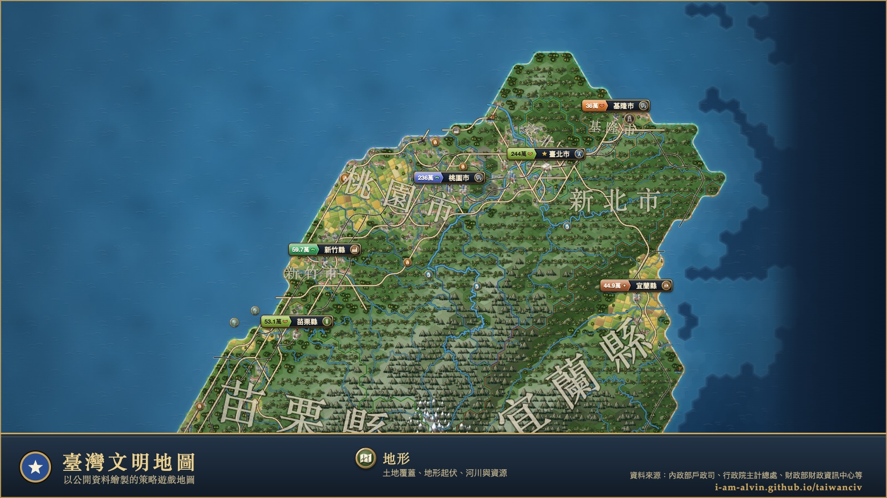
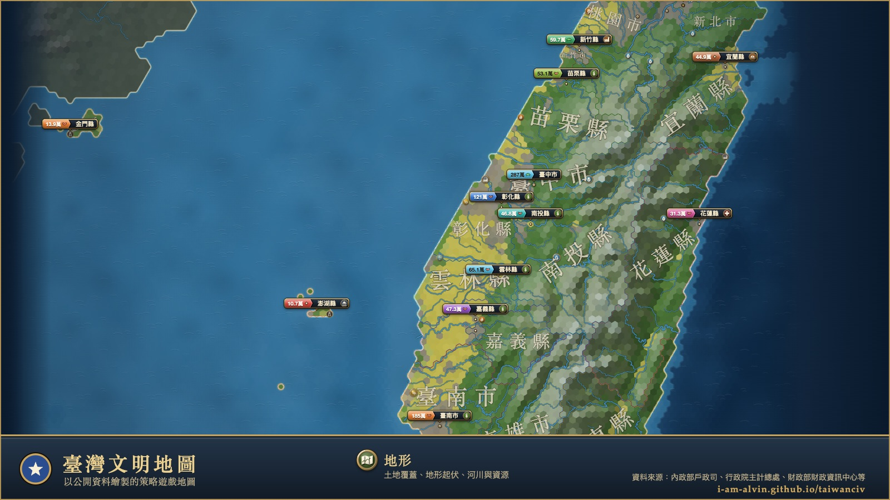
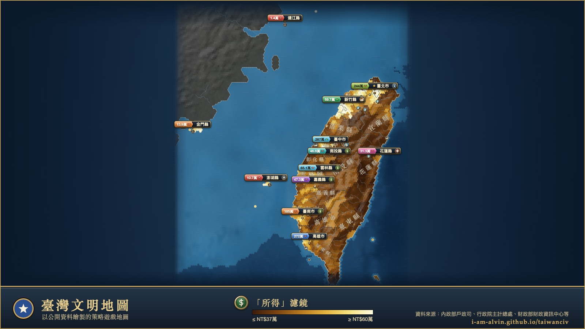
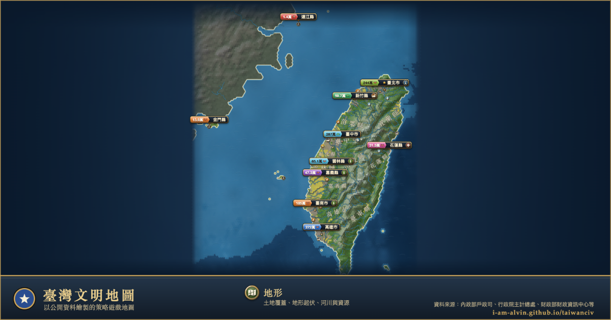

# taiwanciv 臺灣文明地圖：用公開資料畫成策略遊戲地圖的臺灣

**線上版：[i-am-alvin.github.io/taiwanciv](https://i-am-alvin.github.io/taiwanciv/)** · 原始碼：本 repo（站內說明 `?` 也有下載連結）



這是 Andrej Karpathy 的 [usaciv](https://karpathy.ai/usaciv/)（MIT）的臺灣版，前端、資料格式、管線架構一比一移植，
把美國的資料源全部換成臺灣的公開資料。它是視覺化工具，不是遊戲：六角格地形取自高程與地表覆蓋，城市橫幅上的產出
取自就業人數與普查生產毛額，資源是真實的電廠，道路、鐵路、港口、機場與奇觀都落在格子上；另有濾鏡、城市檢視
（市民與城區）和一整組顧問儀表板。每個數字都能在站內的**資料年鑑**追到公開來源、下載網址與檔案雜湊。

純靜態網站：原生 ES modules + Canvas 2D，沒有框架、沒有 npm、沒有建置步驟。資料由只用 Python 標準函式庫的小型
管線產生，來源都是不需要 API key 的公開下載。

<table>
  <tr>
    <td></td>
    <td></td>
  </tr>
  <tr>
    <td></td>
    <td></td>
  </tr>
</table>

## 有什麼

- **地圖**：六角格半徑 2 km（每格約 10.4 km²），臺灣的陸地是 3,548 格（整個地圖範圍連同海面與福建沿岸約
  2.2 萬格）。平原、丘陵、山地、高山，闊葉林、針葉林、農地、建成區、河川、近海與外海；金門、馬祖、澎湖都在圖上。
  所有美術都是程式畫的。
- **產出**：上方列與城市橫幅顯示糧食、生產、金、科學、文化。金是 2021 年工業及服務業普查的生產毛額，其餘是
  人力資源調查各行業的就業人數。點產出可看排行報告。
- **城市**：22 個縣市各是一座城市（縣市政府所在地），368 個鄉鎮市區是底下的郡。
- **地圖設施**：國道與快速公路、省道、高鐵與臺鐵（線形取自 OpenStreetMap），7 個國際商港（依貨物吞吐量），14 座
  機場（依旅客人次分級）。從**地圖**選單開關。
- **資源**：44 座電廠（燃氣、燃煤、燃油、抽蓄、水力、風力、太陽光電），裝置容量取自台電機組資料，位置取自 OSM。
- **貿易路線**：汽車貨運調查中縣市間最大的 40 條公路貨運流量，畫成商隊路線（單位是公噸，不是金額）。
- **濾鏡（19 個）**：人口密度、所得、房價、低所得、年齡中位數、新住民子女、大學學歷、行動網速、日夜人口比、
  住宅使用率、醫師密度、森林、農地、建成地、寺廟密度、主祀神祇、健康福祉、土石流潛勢、原住民。圖例是可刷選的
  直方圖，並寫明每個濾鏡的限制。
- **奇觀與災害**：國家公園、研究經費最多的大學與國定古蹟（各依公開規則選出），以及天然災害損失。
- **城市檢視**：點城市可看
  - **市民**：依職業、年齡、學歷排成一排排小人；
  - **城區**：依縣市就業結構的區位商數（LQ）判定，例如臺北市是「知識城市」；
  - 產業結構、就業人口、資源、相似城市與它在地圖上的範圍。
- **顧問團**：能源與資源、經濟、人口、所得與住房、知識、土地、商貿、文化，以及可任選欄位做表格與散布圖的
  **資料探索**，都和地圖雙向連動。
- **分享與導覽**：每個畫面都有網址（存在 URL hash），可輸出分享圖；`/` 搜尋、`?` 看快捷鍵；手機可用。

## 和美國版的對應

| usaciv | taiwanciv |
|---|---|
| state 州 | 縣市（22，COUNTYCODE） |
| county 郡 | 鄉鎮市區（368，TOWNCODE） |
| metro 都會區 | 縣市（城市 id = COUNTYCODE，成員是其鄉鎮市區） |
| Gold = BEA GDP | 工業及服務業普查生產毛額（新臺幣） |
| 其他產出 = ACS 各行業就業 | 人力資源調查各行業就業（依居住縣市） |
| 25 km 六角格 | 2 km 六角格 |

欄位 id 沿用原版（前端靠它連結），但部分在臺灣代表不同的東西，例如 `poverty` 濾鏡是「第一四分位所得」、
`veterans` 是「原住民人口比例」。完整對照與移植慣例見 [docs/PORTING.md](docs/PORTING.md)。

## 快速開始

需要 [uv](https://docs.astral.sh/uv/)（會自動抓 Python 3.11+），其他都不用裝。

```bash
uv run python -m pipeline serve        # http://127.0.0.1:8765（被占用就加 --port 8790）
```

建好的資料（`web/data/`）已經在 repo 裡，所以這樣就能跑。`web/` 是自足的靜態網站，可直接放到任何靜態主機。
本站部署在 GitHub Pages：`gh-pages` 分支就是 `web/` 的內容。

重新從各發布機關下載並重建資料：

```bash
uv run python -m pipeline all          # 下載（有快取）→ 處理 → 產生 web/data/*.json → 檢查
```

注意事項：

- 政府網站的憑證在 Python 3.13 的嚴格驗證下會失敗，`pipeline/core/fetch.py` 已經關掉 `VERIFY_X509_STRICT`
  （仍驗證憑證鏈與主機名稱）。
- macOS 上抓 Overpass（OpenStreetMap）時若出現憑證錯誤，指定 CA 檔：
  `SSL_CERT_FILE=/opt/homebrew/etc/openssl@3/cert.pem uv run python -m pipeline fetch osm_tw_transport`。

## 運作方式

```
pipeline/
  core/       共用：有出處紀錄的快取下載（fetch.py）、Source 基底類別、投影（geo.py）、六角格（hexgrid.py）
  sources/    每個資料源一個模組：fetch() 下載原始檔，process() → data/interim/<id>.json
  build/      把資料放上六角格 → web/data/*.json
  check.py    依 docs/DATA_CONTRACTS.md 驗證 web/data 並輸出資料品質報告
tests/        unittest（只用標準函式庫）
web/          前端：js/（app、render、ui、ext 擴充）與 data/（瀏覽器載入的 JSON）
docs/         DATA_CONTRACTS.md（每個資料檔的格式）、PORTING.md（臺灣版的移植慣例）
```

流程固定是**資料源 → interim → builder → web/data**。資料源不知道六角格；builder 宣告 `REQUIRES` / `PRODUCES`
依相依順序執行；`catalog` 從資料源註冊表與下載紀錄產生 `sources.json`（資料年鑑的書目，`catalog_zh.py` 提供
中文標題與說明）；`check` 是關卡，任何 FAIL 都會 exit 1。

```bash
uv run python -m pipeline list                        # 資料源與 builder（依建置順序）
uv run python -m pipeline fetch [source …]            # 下載原始檔（有快取；--force 重抓）
uv run python -m pipeline process [source …]          # 原始檔 → data/interim/<source>.json
uv run python -m pipeline build [builder …] [--force] # interim → web/data
uv run python -m pipeline check                       # 驗證 + 資料品質報告（FAIL 時 exit 1）
uv run python -m pipeline package                     # taiwanciv.zip：可上傳的網站，內含原始碼
uv run python -m unittest discover -s tests           # 測試
```

## 資料來源

全部是公開資料，不需要 API key。站內的資料年鑑列出每個檔案的網址、下載日期、大小與 sha256。

<!-- sources:start -->
共 34 個資料源。

| 資料 | 發布機關 | 用在 |
|---|---|---|
| [各鄉鎮市區年底人口與土地面積（ODRP048）](https://www.ris.gov.tw/app/portal/346) | 內政部戶政司 | 城市與縣市人口、2021-2025 年人口成長、鄉鎮市區人口與面積 |
| [人力資源調查 2025 年年報：按行業與縣市分的就業人數](https://www.stat.gov.tw/News_Content.aspx?n=4001&s=236078) | 行政院主計總處 | 糧食、生產、科學與文化產出（按行業分的就業人數）、失業率 |
| [2021 年工業及服務業普查：按縣市分的企業單位](https://data.gov.tw/dataset/111594) | 行政院主計總處 | 金（各縣市的生產毛額） |
| [綜稅總所得各縣市申報統計分析表：每申報戶所得中位數](https://data.gov.tw/dataset/17963) | 財政部財政資訊中心 | 城市、縣市與全國的所得中位數 |
| [縣市與鄉鎮市區界線（TopoJSON）](https://github.com/dkaoster/taiwan-atlas) | 內政部國土測繪中心（由 taiwan-atlas 封裝） | 每個六角格所屬的縣市與鄉鎮市區、縣市界線 |
| [SRTM15+ 全球地形模型（V2）](https://topex.ucsd.edu/WWW_html/srtm15_plus.html) | Scripps Institution of Oceanography；由 NOAA NMFS SWFSC ERDDAP 提供 | 地勢（丘陵、山地、山峰）、山體陰影、海洋深度 |
| [ESA WorldCover 10 m 2021 v200](https://esa-worldcover.org/en) | 歐洲太空總署（ESA WorldCover consortium）；託管於 AWS Open Data Registry | 六角格的土地覆蓋（生物群系）、每個六角格的森林／耕地／建成區比例 |
| [Natural Earth 1:50m（國家、湖泊、河流）](https://www.naturalearthdata.com/) | Natural Earth | 境外陸地（福建沿岸）、湖泊、河流 |
| [土石流潛勢溪流資料](https://data.gov.tw/dataset/7279) | 農業部農村發展及水土保持署 | 各鄉鎮的土石流潛勢溪流數 |
| [文資局古蹟（國定古蹟名冊）](https://data.gov.tw/dataset/6246) | 文化部文化資產局 | 地標奇觀：位置、名稱、指定年份 |
| [民航運輸各機場營運量－按機場分](https://data.gov.tw/dataset/31915) | 交通部民用航空局 | 機場：旅客人次、貨運量、樞紐等級 |
| [各鄉鎮市區住宅使用情形（2020 年人口及住宅普查）](https://data.gov.tw/dataset/162052) | 行政院主計總處 | 有人居住的住宅 |
| [人力資源調查 2025 年年報：按職業與縣市分的就業人數](https://www.stat.gov.tw/News_Content.aspx?n=4001&s=236078) | 行政院主計總處 | 市民：按職業分的勞動力 |
| [不動產買賣實價登錄批次資料](https://plvr.land.moi.gov.tw/DownloadOpenData) | 內政部地政司 | 住宅成交價 |
| [行動通訊速率量測（各鄉鎮市區）](https://data.gov.tw/dataset/161791) | 數位發展部 | 行動網路下載速率 |
| [各鄉鎮市區國中小學新住民子女人數；國民小學名冊](https://data.gov.tw/dataset/146649) | 教育部統計處 | 新住民子女學生數 |
| [大專校院計畫經費（校務資訊公開平臺 研1）、在學學生數與校名錄](https://udb.moe.edu.tw/udata/DetailReportList/研究類) | 教育部：高等教育司與統計處 | 大學奇觀：排名、經費、在學學生數、鄉鎮 |
| [各鄉鎮村里個人綜合所得稅統計（綜合所得稅所得總額統計分析表 165-9）](https://data.gov.tw/dataset/103066) | 財政部財政資訊中心 | 所得中位數、第一四分位數所得 |
| [各鄉鎮市區醫院與診所醫事人力（醫院人力統計、診所人力統計）](https://data.gov.tw/dataset/6474) | 衛生福利部統計處 | 每萬居民的醫師數 |
| [按災害類別分的天然災害損失（內政統計查詢網 表 c0720101）](https://data.gov.tw/dataset/14368) | 內政部統計處，資料來源：內政部消防署 | 災害：按年份與類別的全國紀錄 |
| [國家公園遊憩人次與面積（內政統計查詢網 表 c0820401、c0820101）](https://data.gov.tw/dataset/13476) | 內政部統計處，資料來源：內政部國家公園署 | 國家公園奇觀：遊憩人次與面積 |
| [以行動通訊網路信令推估的各鄉鎮市區日間與夜間人口（電信信令人口統計）](https://data.gov.tw/dataset/162907) | 內政部統計處 | 日夜間人口比 |
| [寺廟登記資料（全國宗教資訊網）](https://religion.moi.gov.tw/) | 內政部宗教及禮制司 | 每萬居民的寺廟數、最常見的主祀神明 |
| [汽車貨運調查報告：縣市間貨物運量（表 5）](https://data.gov.tw/dataset/6307) | 交通部統計處 | 貿易路線：縣市間貨車貨運噸數 |
| [2022-2024 年中央災害應變中心開設期間的災害案件通報](https://data.gov.tw/dataset/173936) | 內政部消防署，緊急應變管理資訊雲（EMIC） | 災害：有通報案件的開設場次，按鄉鎮市區與縣市 |
| [113-114 年國土利用現況調查成果鄉鎮市區統計資料](https://data.gov.tw/dataset/178038) | 內政部國土測繪中心 | 森林比例、農地比例、建地比例 |
| [國家公園範圍輪廓（OpenStreetMap boundary=national_park relations）](https://www.openstreetmap.org/) | OpenStreetMap contributors，經由 Overpass API | 國家公園奇觀：位置與受保護的六角格 |
| [發電廠位置（OpenStreetMap power=plant）](https://www.openstreetmap.org/) | OpenStreetMap contributors，經由 Overpass API | 資源圖層上的電廠、水壩與風力發電場位置 |
| [國道、快速公路、省道、鐵路、機場與港口（OpenStreetMap）](https://www.openstreetmap.org/) | OpenStreetMap contributors，經由 Overpass API | 地圖上的國道、快速公路與省道、地圖上的鐵路、機場與商港位置 |
| [各鄉鎮市區的年齡、教育程度、原住民身分與死亡人數（ODRP014、ODRP020、ODRP013、ODRP031）](https://www.ris.gov.tw/rs-opendata/api/Main/docs/v1) | 內政部戶政司 | 年齡中位數、大學學歷、原住民比例、福祉（標準化死亡比）、戶數 |
| [發電機組與裝置容量（台灣電力公司_各機組發電量）](https://data.gov.tw/dataset/8931) | 台灣電力公司 | 電廠、水壩、抽蓄水力、風力與太陽能發電場：裝置容量（MW） |
| [臺灣地區國際商港貨物吞吐量](https://data.gov.tw/dataset/8369) | 臺灣港務股份有限公司 | 港口：貨運噸數、進口、出口、國內貨物 |
| [臺灣河川（OpenStreetMap river relations）](https://www.openstreetmap.org/) | OpenStreetMap contributors，經由 Overpass API | 河川 |
| [臺灣大專校院座標（Wikidata）](https://www.wikidata.org/) | Wikidata（Wikimedia Foundation） | 大學奇觀：地圖上的位置 |
<!-- sources:end -->

### 怎麼誠實地讀這張圖

地圖畫得像遊戲，但數字是真的，所以要知道比喻在哪裡停下來：

- **產出只是幫真實數字取的名字。** 糧食、生產、科學、文化是各行業就業人數，依**居住**縣市計（人力資源調查，
  抽樣調查，千人為單位）。金門縣、連江縣不在人力資源調查範圍內，這兩縣的就業與失業率是空值。
- **金不是 GDP。** 臺灣沒有官方縣市 GDP；金用的是 2021 年工業及服務業普查的生產毛額，依**企業登記地**歸屬，
  不含農業與政府部門。多據點企業整筆算在總部所在縣市，所以臺北市約占全國四成，新竹市約是臺南市的三倍。
- **所得是報稅資料，不是家戶所得。** 縣市的所得中位數是綜合所得稅每一納稅單位的總所得（2023 所得年度）；鄉鎮
  市區的所得濾鏡用的是另一張表的綜合所得總額，兩者不能互相比較。
- **部分濾鏡是替代指標。** 臺灣沒有鄉鎮市區別的貧窮率、寬頻訂閱率、通勤時間、健保覆蓋率，對應的濾鏡改用第一
  四分位所得、行動網速實測、日夜人口比、醫師密度，每個濾鏡的說明都寫明了。
- **貿易路線是公路貨運噸數**，不含海運、空運，也不是貿易金額。
- **位置是示意的。** 每格約 10.4 km²；道路與鐵路是簡化過的線條；城區標示的是縣市的產業特化，不是工作地點。
  城市類型依區位商數判定，接近門檻時可能因四捨五入改變。
- **缺的資料就是缺的**：空值，絕不填 0 或估計值。
- **刻意不做軍事圖層。** 軍事基地不是開放資料，標示它們也敏感。
- 東沙、南沙（高雄市旗津區）在地圖範圍外；烏坵沒有畫在圖上。

### 授權與致謝

- 程式碼以 MIT 授權（見 [LICENSE](LICENSE)），沿用 Andrej Karpathy 的 [usaciv](https://karpathy.ai/usaciv/)
  （MIT）。部分介面用語參考 [chuanyuj/twciv](https://github.com/chuanyuj/twciv)（MIT）。
- 授權只涵蓋程式碼，不含資料。政府資料依「政府資料開放授權條款－第 1 版」使用；OpenStreetMap 資料 © OpenStreetMap
  contributors（ODbL 1.0）；ESA WorldCover（CC BY 4.0）；Natural Earth 與 SRTM15+ 為公有領域；Wikidata 為 CC0。
  各來源的確切條款見資料年鑑。
- 視覺風格受回合制 4X 策略遊戲啟發，但所有圖示與材質都是原創、用程式畫的。本專案與任何遊戲發行商無關。

## 之後可以做的

- 選舉結果濾鏡（中選會開放資料）。
- 農業部的作物產量作為農業資源。
- 時間軸：`cities.json` 已有 2020 年起的逐年人口。
- 鄉鎮市區層級的就業結構（需要普查的場所單位資料）。
